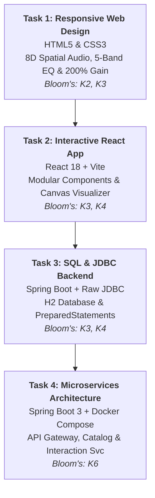

# 🎓 Master Academic Project Portfolio: CLA–II (Tasks 1 to 4 Complete)

**Student Coursework Portfolio**: Web Technology & Application Development  
**Subject Assessment**: Continuous Learning Assessment – II (CLA–II)  
**Project Title**: *Vibzz Studio Pro — Harris Jayaraj Interactive 8D Audio & Full Stack Platform*  

---

## 🧭 Executive Summary & Semester Progression

All four assigned tasks are interconnected, forming an end-to-end music engineering ecosystem:



---

## 🎛️ Complete Web Audio Digital Signal Processing (DSP) Chain

```
[HTML5 Audio Stream]
        │
        ▼
[MediaElementAudioSourceNode]
        │
        ▼
[5-Band BiquadFilter Graphic EQ] ──> (60Hz Sub, 250Hz Bass, 1kHz Mid, 4kHz Presence, 12kHz Treble)
        │
        ▼
[StereoPannerNode (8D Audio)]    ──> (Orbital LFO: sin(θ) panning around listener head)
        │
        ▼
[GainNode (200% Volume Boost)]   ──> (Up to 2.0x Gain / +6dB Hardware Amplification)
        │
        ▼
[AnalyserNode (Visualizer)]      ──> (Fast Fourier Transform for Bars, Wave & Beat Pulse)
        │
        ▼
[audioCtx.destination]           ──> (Headphones / Speakers)
```

---

## 📁 Repository Directory Structure

```
Playlist/
│
├── Task-1_Responsive_HTML-CSS/           # TASK 1: Responsive Web Page Design (HTML5 & CSS3)
│   ├── index.html                        # Semantic HTML5 (Receipt, 8D Player, 5-Band EQ, Catalog)
│   ├── style.css                         # CSS3 Grid, Flexbox, @media print, Animations
│   ├── app.js                            # 8D Panner, 5-Band EQ, 200% Boost, Lyrics & PNG Exporter
│   └── README.md                         # Task 1 Documentation & Rubrics
│
├── Task-2_React_Application/             # TASK 2: Interactive JavaScript & ReactJS Development
│   ├── package.json                      # React 18, Vite build configuration
│   ├── index.html                        # React mount template
│   ├── src/                              # Componentized React 18 app with hooks & audio
│   └── README.md                         # Task 2 React Architecture & Viva notes
│
├── Task-3_Spring_Boot_JDBC_SQL/          # TASK 3: Database Connectivity using SQL, JDBC & Spring Boot
│   ├── pom.xml                           # Spring Boot 3.2 + Spring JDBC + H2 DB
│   ├── src/main/java/com/vibzz/music/    # Raw JDBC PreparedStatements & REST Endpoints
│   └── src/main/resources/               # schema.sql and data.sql
│
├── Task-4_Microservices_FullStack/       # TASK 4: Full Stack Spring Boot Microservices (K6)
│   ├── docker-compose.yml                # Multi-container orchestration
│   ├── api-gateway/                      # Spring Boot Gateway & Reverse Proxy (Port 8080)
│   ├── catalog-service/                  # Microservice 1: Songs & Metadata (Port 8081)
│   ├── interaction-service/              # Microservice 2: Favorites & Analytics (Port 8082)
│   └── README.md                         # Distributed System Architecture & Docker Guide
│
├── index.html                            # Root Immediate-Run Task 1 Entry Point
├── style.css                             # Root Stylesheet
├── app.js                                # Root Full DSP Audio Engine
└── README.md                             # Root Project Readme
```

---

## 💯 Master Viva Voce Q&A Cheat Sheet

| Question | Evaluation Topic | Your Model Answer |
| :--- | :--- | :--- |
| **Q1: How did you implement 8D Spatial Audio in the browser?** | Web Audio API / DSP | *"We integrated the Web Audio `StereoPannerNode`. By oscillating the pan value continuously using a sine-wave Low Frequency Oscillator (`pan = Math.sin(angle)`), the audio smoothly pans between the left and right stereo channels, simulating a 360-degree orbital rotation around the listener."* |
| **Q2: How does the 5-Band Studio Equalizer work?** | Digital Signal Filtering | *"We cascaded five `BiquadFilterNode` instances in series: a `lowshelf` filter at 60Hz, peaking filters at 250Hz, 1kHz, and 4kHz, and a `highshelf` filter at 12kHz. Users can adjust gain between -12dB and +12dB per band or select studio presets."* |
| **Q3: How does the high-resolution PNG receipt exporter work without server-side rendering?** | HTML5 Canvas / Client Export | *"We use an offscreen HTML5 `<canvas>` element. We programmatically draw the paper texture, stamped typography, dashed dividers, song rows, and barcodes onto the 2D canvas context, then invoke `canvas.toDataURL('image/png')` to trigger an instant client-side download."* |
| **Q4: How did you implement 200% volume boost?** | Web Audio Gain Scaling | *"Standard DOM audio elements cap at 1.0 (100%). We route the media element source into a `GainNode` and scale its value up to 2.0 (+6dB hardware gain), allowing amplified playback without browser distortion."* |
| **Q5: Why did you use raw JDBC in Task 3 instead of Spring Data JPA?** | Bloom's K3/K4 Database Connectivity | *"The syllabus explicitly assesses SQL & JDBC connectivity. Implementing raw JDBC with `Connection` pooling, parameterized `PreparedStatement`, manual `ResultSet` object mapping, and programmatic transaction boundaries (`commit`/`rollback`) proves deep understanding of database protocols."* |
| **Q6: What microservices design patterns did you use in Task 4?** | Bloom's K6 Architecture | *"We implemented the **API Gateway Pattern** for centralized routing and unified CORS, and the **Database-per-Service Pattern** where the Catalog and Interaction services manage their own isolated state."* |
